<div align="center">

# Cortex GitOps

### Production-style GitOps delivery of a monitoring platform to a **3-node HA Kubernetes cluster on Azure**, with automated TLS, sealed secrets and a private link to an on-prem OpenStack lab.

<br/>


**Live demo (when the environment is up):** `https://cortex.cortexmonitoring.dev`  
*The environment is created and destroyed on demand to keep cost near zero. See the [evidence gallery](#-evidence-of-a-live-deployment).*

</div>

---

## Table of contents

1. [At a glance](#at-a-glance)
2. [Architecture](#architecture)
3. [Technology stack](#technology-stack)
4. [Azure infrastructure (Terraform)](#azure-infrastructure-terraform)
5. [GitOps design](#gitops-design)
6. [Delivery pipeline and image hardening](#delivery-pipeline-and-image-hardening)
7. [Security](#security)
8. [Hybrid connectivity to the lab](#hybrid-connectivity-to-the-lab)
9. [Evidence of a live deployment](#evidence-of-a-live-deployment)
10. [Engineering log: problems found and fixed](#engineering-log-problems-found-and-fixed)
11. [Cost management](#cost-management)
12. [Repository layout](#repository-layout)
13. [Runbook](#runbook)
14. [Related repositories](#related-repositories)

---

## At a glance

| | |
|---|---|
| **What it is** | The desired state of the [Cortex](https://github.com/LAKHAL-Farah/Cortex) platform (API, web UI, PostgreSQL, Neo4j) and the platform services around it |
| **Where it runs** | 3 Ubuntu 24.04 VMs on Azure (`austriaeast`) running k3s with embedded etcd, no public IPs on the nodes |
| **What it monitors** | A private 3-node OpenStack 2024.2 cloud (Kolla-Ansible) that I built, kept on-prem as the data plane |
| **How it is delivered** | CI builds and signs images, then opens a PR here that bumps **image digests**. Argo CD reconciles `main` into the cluster |
| **How it is secured** | Sealed Secrets (ciphertext only in Git), Pod Security `restricted`, digest-pinned images, gitleaks, host firewalls on the lab |
| **How it reaches the lab** | ZeroTier overlay with iptables allow-lists on the lab nodes |
| **What it costs** | About **$0.35 per hour**, built and destroyed with two commands |
| **Reproducibility** | One `terraform apply` (32 resources), then a scripted runbook. Full go-live in roughly 1.5 hours |

---

## Architecture


### Delivery pipeline

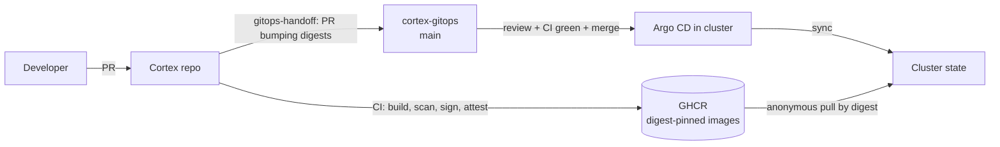
> **Principle:** CI never deploys. It proposes a change. A human reviews and merges it, and Argo CD applies exactly what is in `main`.

---

## Technology stack

### Cloud and infrastructure


-ED1944?style=flat-square&logo=openstack&logoColor=white)

### Kubernetes platform


### GitOps, CI and supply chain


-326CE5?style=flat-square&logo=docker&logoColor=white)

### Application workloads


### Design choices

| Decision | Why |
|---|---|
| **k3s with embedded etcd** instead of AKS | Real 3-node HA at a fraction of the cost, full control over the control plane, and a lab that mirrors on-prem constraints |
| **Standard Load Balancer, VMs without public IPs** | One public entry point, nodes are not directly reachable. An explicit outbound rule lets private nodes pull images |
| **Argo CD with manual sync** | Short-lived environment: nothing changes behind the operator's back. Auto-sync is a one-line switch for long-lived clusters |
| **Kustomize base and overlays** | One neutral base derived from the compose stack, with overlays for k3d and Azure, so rehearsal and production share manifests |
| **Digest-pinned images** | Immutable, auditable deployments, bumped only through reviewed PRs |
| **Sealed Secrets** | Git stays the single source of truth without storing plaintext, and works with the pull-based GitOps model |
| **cert-manager, staging then production** | Debug issuance against the staging CA without burning Let's Encrypt rate limits |
| **ZeroTier overlay + host firewalls** | Private Azure to lab path without exposing lab ports to the internet. The overlay is flat, so the lab nodes enforce their own allow-list |
| **Rehearse on k3d first** | The full GitOps loop is tested for free before spending money |
| **Hub-and-spoke hybrid** (Cortex in Azure, data in the lab) | Data gravity: telemetry, SSH keys and lab credentials stay on-prem. Only the "brain" runs in the cloud |
| **Collector stays in the lab** | It holds the SSH keys to the nodes and the node agents push alerts *to it*. Moving it to Azure would put lab keys in the cloud and invert the data flow |
| **Exactly 3 control-plane nodes** | A 2-node etcd has no quorum. Three is the minimum that survives the loss of one node |
| **Nodes join through node 1's private IP, never the LB** | Backend VMs of an Azure load balancer cannot reliably reach their own frontend, so the LB is used for external access only (`--tls-san` covers its public name) |
| **Azure LB instead of a virtual-IP tool** | ARP-based tools such as kube-vip layer 2 do not work on Azure virtual networks |
| **Neo4j as a single instance** | Clustering is an Enterprise feature. Treated as a rebuildable projection of OpenStack and Prometheus data, not a source of truth |
| **Ephemeral environment** | Fits a credit budget and makes cost discipline part of the design: stand up, prove, record, destroy |

---

## Azure infrastructure (Terraform)

The Azure environment is defined in a companion Terraform repository, `cortex-infra`, which is private. Everything it builds is documented here: one `terraform apply` creates the whole environment and one `terraform destroy` removes it.

### Module composition


| Component | Detail |
|---|---|
| **Region / scope** | `austriaeast`, resource group `cortex-demo-rg` |
| **Compute** | 3 Ubuntu 24.04 VMs, `Standard_B2s_v2` (2 vCPU / 8 GB), 64 GB StandardSSD, static private IPs `172.20.1.4` to `.6`, no public IPs |
| **Entry point** | One Standard Load Balancer with a static public IP |
| **Network** | VNet `172.20.0.0/16`, subnet `172.20.1.0/24`, NSG |
| **State** | Remote Terraform state in a storage account in its own resource group, Entra ID authentication, so `destroy` can never delete the backend |
| **Versions** | k3s `v1.34.11+k3s1` pinned through a variable, provider versions constrained, `.terraform.lock.hcl` committed |
| **Tags** | `project`, `owner` and `ttl` on every resource |
| **Size** | **32 resources** in a single plan |

### Network and traffic flow

.png>)

- **NSG:** default-deny inbound with two allow rules. Web ports from anywhere. SSH and the Kubernetes API only from a single admin `/32`, which Terraform validates (a wider range is rejected at plan time).
- **No public IPs on VMs.** The load balancer is the only inbound path, and SSH reaches each node through its own NAT rule.
- **Explicit outbound rule.** Private nodes still need to pull images and reach ZeroTier, so outbound SNAT is configured deliberately instead of relying on defaults.
- **VNet range chosen to avoid overlaps** with the ZeroTier network (`10.0.1.0/24`) and the k3s pod and service ranges (`10.42.0.0/16`, `10.43.0.0/16`).

### Node bootstrap (cloud-init)

Each VM renders a bootstrap script from a template. It installs ZeroTier, then forms or joins the k3s cluster.

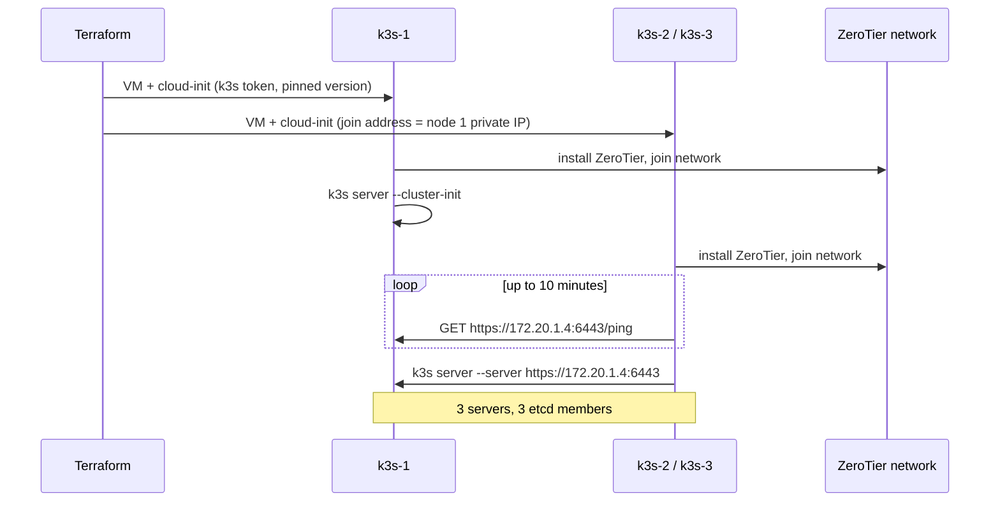

Design points:

- **3 servers, all schedulable.** A 2-node etcd has no quorum, and three is the minimum that survives the loss of one node.
- **Nodes 2 and 3 join through node 1's private IP, never through the load balancer.** Backend VMs of an Azure load balancer cannot reliably reach their own frontend. The LB's public address is added with `--tls-san`.
- **k3s flags:** `--cluster-init`, `--node-ip` and `--flannel-iface eth0` (pod traffic stays on the Azure NIC, off the ZeroTier interface), and `--secrets-encryption` so Kubernetes Secrets are encrypted at rest in etcd.
- **Hardened downloads.** Installers are fetched to a file with connect and total timeouts and five retries, executed only after a complete download, and run under `timeout`. Joiners wait up to 10 minutes for node 1 and fail loudly if it never answers.
- **Generated token.** The k3s join token comes from `random_password`, not from a file.

### Security and quality of the Terraform code

- SSH key authentication only (`disable_password_authentication`), and VM extensions are disabled (`allow_extension_operations = false`).
- Inputs are validated: the admin source must be a `/32` and the ZeroTier network ID must be 16 lowercase hex characters.
- **Checkov** scans the code in CI. The one skipped check (port 80 open) is documented inline, because Let's Encrypt HTTP-01 and the HTTPS redirect need it.
- CI runs `terraform fmt -check`, `init -backend=false`, `validate` and Checkov on every change, with `actions/checkout` pinned by commit SHA.
- State, plans and variable files are gitignored, and a documented example file lists every input without real values.

### Cost guard rails

- A resource-group **budget** with 50%, 80% and 100% e-mail alerts.
- Mandatory `ttl` and `owner` tags for cleanup.
- **`teardown.sh`** removes the DNS record, destroys everything and lists any leftovers.
- **Infracost** estimate: about **$0.35 per hour**, or $257 per month if left running.

### Verification scripts

`smoke-check.sh` exists because `terraform plan` cannot catch capacity errors, cloud-init failures or network-path problems.

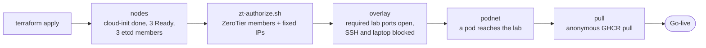

| Script | Purpose |
|---|---|
| `smoke-check.sh nodes \| overlay \| podnet \| pull` | Post-apply checks of the cluster, overlay allow-list, pod networking and image pull |
| `zt-authorize.sh` | Authorises the three ZeroTier members and assigns `10.0.1.8` to `.10` |
| `lab-firewall.sh` | iptables raw-table allow-list on the lab nodes |
| `dns.sh up \| down \| status` | Creates, removes and checks the Cloudflare A record |
| `evidence.sh` | Snapshots cluster state for the write-up |
| `teardown.sh` | DNS record, `terraform destroy`, leftover check |

### Environment lifecycle

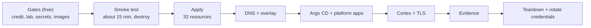

---

## GitOps design

- **Argo CD** is installed from a pinned, checksum-verified manifest and scoped by an **AppProject**.
- Four Applications: `sealed-secrets`, `cert-manager`, `cluster-issuers`, and `cortex-azure` (Kustomize overlay `overlays/azure`).
- Platform components are installed from pinned Helm chart versions, and cluster-scoped config (the Let's Encrypt `ClusterIssuer`s) lives in `platform/`.
- **Order matters and is scripted:** Argo CD, then **restore the sealing key**, then sealed-secrets and cert-manager, then issuers, then the application. Restoring the key before the controller starts is what lets committed ciphertext decrypt on a brand-new cluster.
- Every environment change is a **pull request**: image digest bumps, enabling a sealed secret, switching from the staging to the production certificate. The Argo history maps each deployment to a merged PR.

---

## Delivery pipeline and image hardening

<!-- VERIFY against the Cortex repo workflow before publishing: delete any row that is not in your CI. -->
The application repository ([`Cortex`](https://github.com/LAKHAL-Farah/Cortex)) owns the build. Its CI produces the artifacts this repo deploys.

| Stage | Tooling |
|---|---|
| Secret scanning | Gitleaks |
| Lint and static analysis | Ruff, ESLint, SAST |
| Dependency audit | `pip-audit`, `npm audit` |
| Tests | pytest, **1000+ tests** green in CI |
| Build | Docker Buildx, multi-stage, layer cache |
| Image scan | Trivy |
| SBOM | Syft |
| Signing and provenance | Cosign (keyless, GitHub OIDC), attestations |
| Publish | GHCR, tagged by git SHA and **deployed by digest** |
| Handoff | CI opens a pull request in this repo bumping the digest. It never deploys |

CI follows least privilege: scoped `permissions:` per job and third-party actions pinned by commit SHA.

**Image and runtime hardening** (applied in the Cortex repo, enforced by the manifests here):

- Non-root user, read-only root filesystem, no source bind mount, development dependencies split out of the runtime image.
- Production start-up refuses a default or missing admin password.
- Base images pinned by digest.
- SMTP settings passed through to the API, a Loki client that tolerates empty label results, and a start-up warning when the OpenStack `clouds.yaml` or the `cortex-reader` profile is missing.

**Lab readiness.** Before the Azure cluster could read the lab, the lab was prepared:

- A least-privilege Keystone identity, `cortex-reader` (`reader` role), with a dedicated `clouds.yaml` profile.
- Only the required endpoints exposed on the overlay: Keystone 5000, Nova 8774, Neutron 9696, Cinder 8776, Prometheus 9090, Loki 3100 and the collector on 9110 (controller), and node exporter 9100 (compute).
- The collector bound to the controller's overlay address, with remediation execution switched off.
- Three overlay addresses (`10.0.1.8` to `.10`) reserved for the Azure nodes.

---

## Security

| Area | Control |
|---|---|
| **Pod hardening** | `runAsNonRoot`, `seccompProfile: RuntimeDefault`, all capabilities dropped, no privilege escalation, no service-account token, requests and limits. `readOnlyRootFilesystem` on all pods except Neo4j. Namespace enforces the Pod Security **`restricted`** profile |
| **Secrets** | Only SealedSecrets in Git. CI fails if the Azure overlay renders a plaintext `Secret`. Sealing key backed up offline and verified by certificate fingerprint |
| **Credentials** | Read-only `cortex-reader` OpenStack account. The operator account is never mounted. Remediation execution is off (`CORTEX_REMEDIATION_EXECUTION=off`). All session credentials are rotated at teardown |
| **Supply chain** | Digest-pinned images, built, scanned, signed and attested in CI. gitleaks on every PR |
| **Network edge** | No public IPs on nodes, NSG limited to one admin CIDR, SSH only via LB NAT rules |
| **Lab protection** | iptables allow-list on the lab nodes admits only the Azure nodes, only on required ports. A smoke test proves SSH, other ports and the operator's laptop are unreachable from Azure |
| **TLS** | HTTP-01 certificates issued by cert-manager, trusted production chain, automatic renewal |

---

## Hybrid connectivity to the lab

The Azure cluster consumes metrics, logs and OpenStack inventory from an on-prem lab (controller, compute and storage nodes).

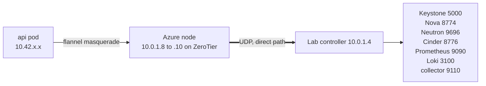

- Pods leave through the node, so the source address is one the lab firewall allows.
- ZeroTier allows everything by default, so `lab-firewall.sh` applies an **iptables raw-table** allow-list on the lab hosts. The raw table is used because it also covers Docker-published ports, which ufw and INPUT rules miss.
- The hard-won lesson: a hybrid link is only as good as its worst NAT. See the engineering log below.

---

## Evidence of a live deployment

> Captured during the verified go-live. Files live in `docs/images/`.

### GitOps in Argo CD

<table>
<tr>
<td width="50%">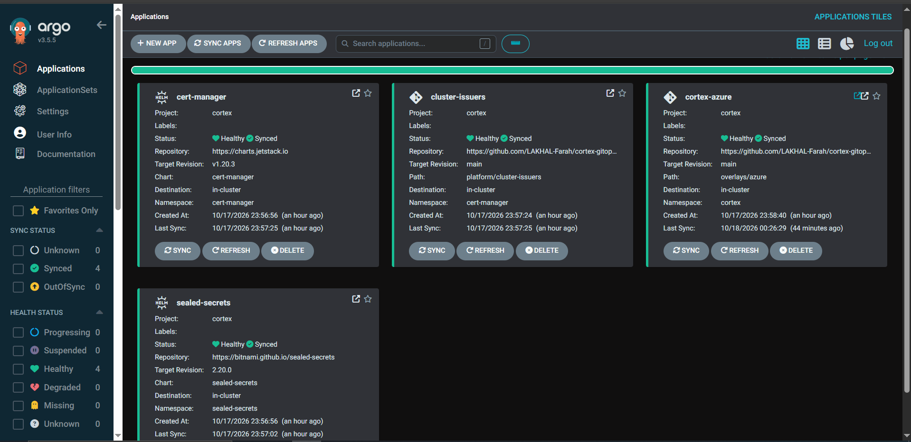<br/><sub><b>All four applications Synced and Healthy</b>, deployed from <code>main</code>.</sub></td>
<td width="50%">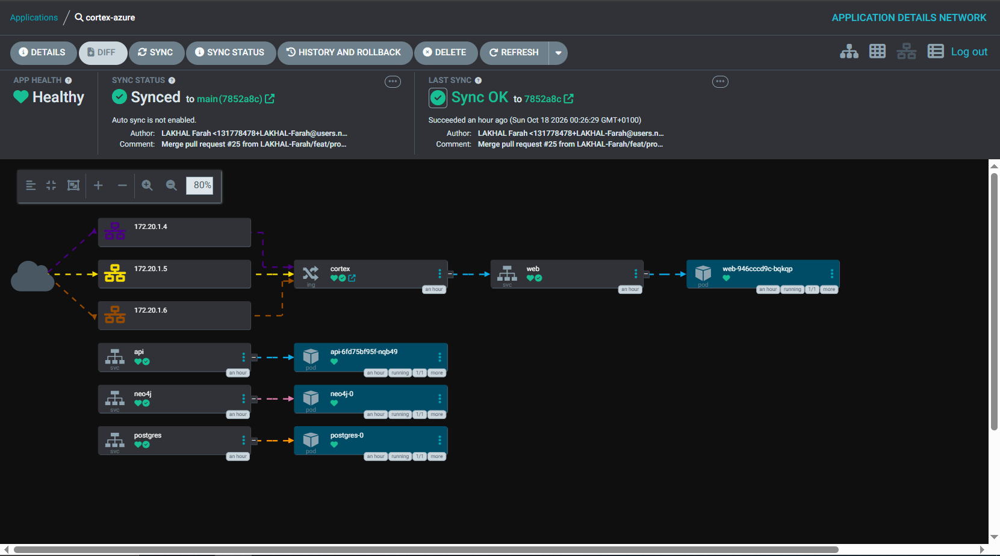<br/><sub><b>Request path:</b> load-balanced ingress to <code>web</code>, then <code>api</code>, <code>neo4j</code> and <code>postgres</code>.</sub></td>
</tr>
<tr>
<td width="50%">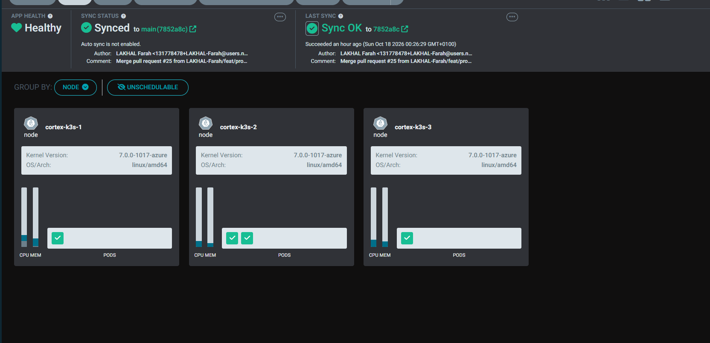<br/><sub><b>Three-node cluster</b> with workloads scheduled across nodes.</sub></td>
<td width="50%">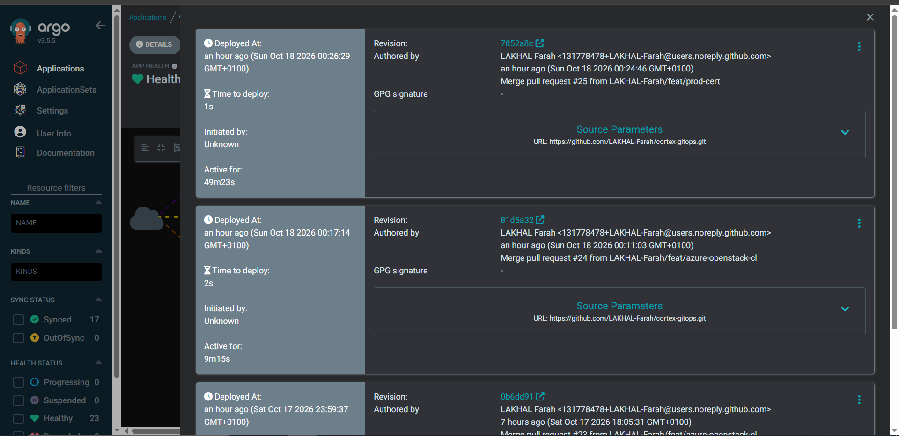<br/><sub><b>Audit trail:</b> each deployment maps to a merged pull request.</sub></td>
</tr>
</table>

### Cluster, TLS and Azure

<table>
<tr>
<td width="50%">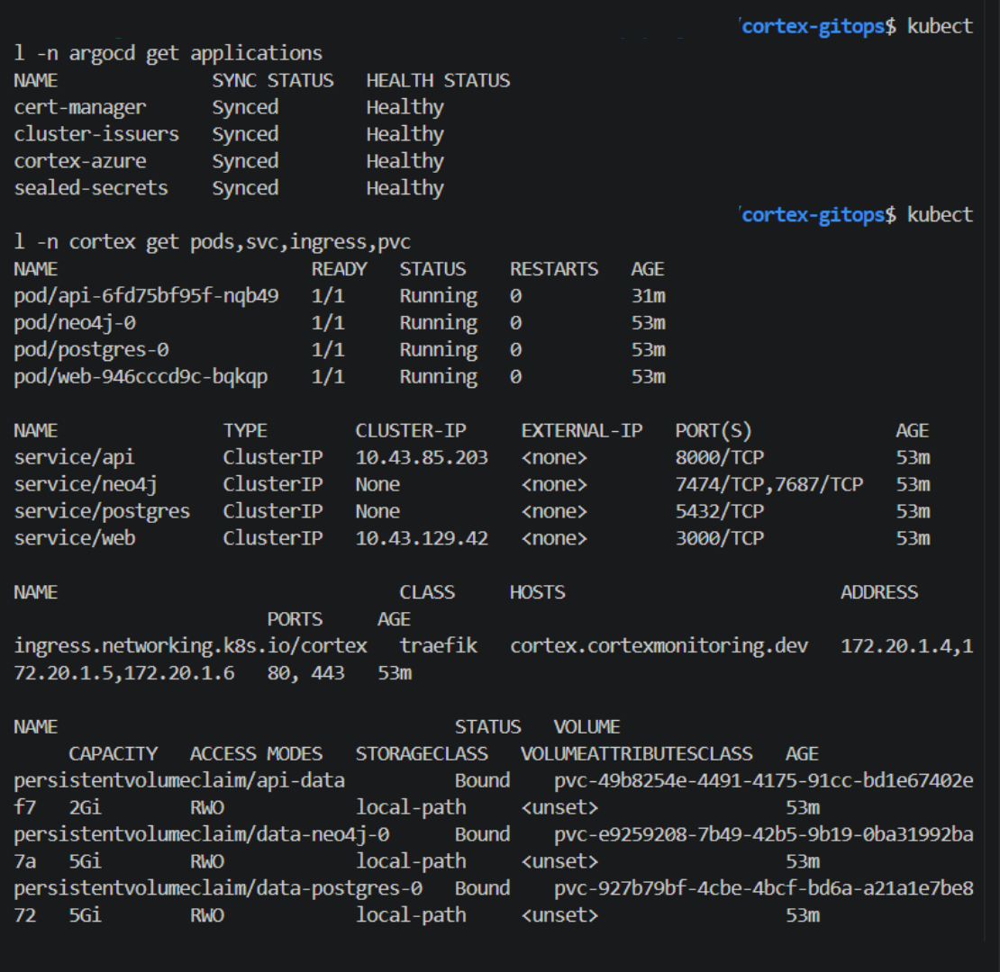<br/><sub><b>Cluster state:</b> pods Running, PVCs Bound, ingress for the public hostname.</sub></td>
<td width="50%">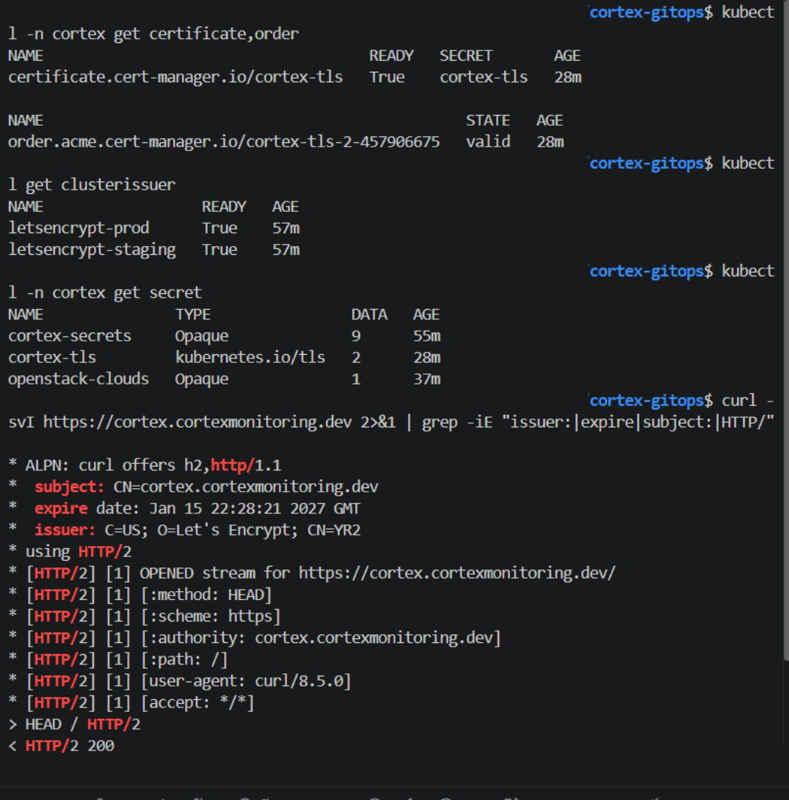<br/><sub><b>Trusted TLS:</b> Let's Encrypt production issuer, valid until 15 Jan 2027, <code>HTTP/2 200</code>.</sub></td>
</tr>
<tr>
<td width="50%" colspan="2">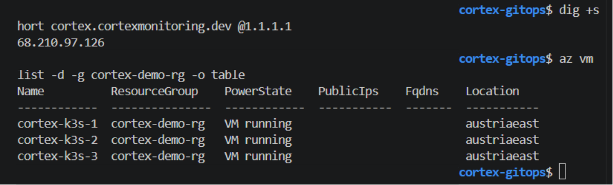<br/><sub><b>Azure:</b> three VMs running in <code>cortex-demo-rg</code>, DNS resolving to the load balancer.</sub></td>
</tr>
</table>

<!-- Add the application screenshots here once captured:
### The application


-->

---

## Engineering log: problems found and fixed

A paid smoke test before go-live caught defects that a plan never would have. Each was diagnosed with evidence, fixed, and re-verified.

<details>
<summary><b>1. cloud-init hung on an unbounded download</b> (happened on 2 of 3 applies)</summary>

- **Symptom:** one node stuck at `status: running`, k3s never installed, so the other nodes failed to join.
- **Evidence:** `ps` showed a `curl -fsSL https://install.zerotier.com | bash` running for 7+ minutes while network checks to the same host returned 200.
- **Root cause:** a piped download with no timeout waits forever on a stalled connection.
- **Fix:** download to a file with connect and total timeouts, up to 5 retries, execute only after a complete download, run the installer under `timeout`, make joiners wait up to 10 minutes for node 1 and **fail loudly** if it never answers.
- **Result:** the next three clean applies completed with 3 Ready nodes and 3 etcd members.
</details>

<details>
<summary><b>2. Double NAT made the lab unreachable half the time</b></summary>

- **Symptom:** `No route to host` on about half of connections from Azure to the lab. Pods and hosts failed identically, so Kubernetes was ruled out.
- **Evidence:** the controller listed every Azure node as `RELAY` with latency `-1`, while Azure nodes had `DIRECT` paths to everything else.
- **Root cause:** the controller VM sat behind hypervisor NAT and then the home router, so UDP hole punching could not complete.
- **Fix:** a second bridged network adapter with its own routing table and ZeroTier restricted to it. The adapter that OpenStack uses was left untouched so no service address changed.
- **Result:** all Azure nodes `DIRECT`, 10/10 connection tests per node on repeated runs.
</details>

<details>
<summary><b>3. MTU black hole on the overlay</b></summary>

- **Symptom:** small Prometheus replies returned in 0.1 s, a 20 KB response timed out at 20 s, and the API logged read timeouts on metric collection.
- **Root cause:** large packets were dropped on the overlay path.
- **Fix:** lowered the overlay interface MTU. The same request then completed in 0.2 s.
</details>


---

## Cost management

The whole environment runs at roughly **$0.35 per hour** (Infracost estimate: $257/month if left running).

| Session | Approx. cost |
|---|---|
| 15 minute smoke test | $0.09 |
| 3 hour go-live | $1.06 |
| Forgotten for a day | $8.50 |

Controls: budget alerts, a hard **stop rule** (if the system is not converging after 1.5 hours, capture evidence and destroy), and a teardown script that deletes the resource group, removes the DNS record and lists anything left over. Only the small Terraform-state group persists.

---

## Repository layout

```
.
├── base/                  Environment-neutral manifests (derived from the compose stack)
├── overlays/
│   ├── k3d/               Local rehearsal: local images, DEV secrets, mail sink
│   ├── k3d-sealed/        Same, with secrets from a SealedSecret
│   └── azure/             Azure: digest-pinned images, SealedSecrets, ingress + TLS
├── apps/                  Argo CD AppProject and Applications
├── platform/
│   └── cluster-issuers/   Let's Encrypt staging and production ClusterIssuers
├── scripts/               validate, k3d helpers, secret sealing, sealing-key backup/restore
├── .github/               CI: kustomize build, kubeconform, gitleaks, plaintext-secret guard
└── secrets.env.example    Template for the (gitignored) secrets file
```

### Workloads

| Workload | Kind | Notes |
|---|---|---|
| `api` | Deployment, 1 replica, `Recreate` | Probes `/health` and `/health/db`. Runs as a single instance so the in-process schedulers fire once |
| `web` | Deployment | Probes `/login` |
| `postgres` | StatefulSet + PVC | `postgres:16` |
| `neo4j` | StatefulSet + PVC | `neo4j:5-community` |
| `collector` | Runs in the lab on Azure | Security collector with SSH access to the nodes it inspects |

**Image optimisation.** The API image went from **16.9 GB to 2.89 GB** uncompressed (6.67 GB to **659 MB** compressed) by replacing the default CUDA-bundled `torch` wheel with the CPU-only build and moving to a multi-stage Dockerfile. That is what makes pulling images onto small VMs practical.

**Sizing.** Measured steady-state memory for the deployable set is about 1.3 GB (api ~700 MiB, neo4j ~520 MiB, postgres ~56 MiB, web ~52 MiB), so three 8 GB nodes leave comfortable headroom after k3s and the platform add-ons.

---

## Runbook

<details>
<summary><b>Expand the go-live sequence</b></summary>

1. **Gates (free):** credit check, lab services reachable over the overlay, lab firewalls applied, reader credential verified, secrets sealed and the key backed up offline, images pullable anonymously.
2. **Smoke test (about $0.15):** `terraform apply`, then `smoke-check.sh nodes`, `overlay`, `podnet`, `pull`, then destroy.
3. **Go-live:**
   1. `terraform apply` (32 resources) and DNS record
   2. Authorise the ZeroTier members, verify the overlay
   3. Install Argo CD, **restore the sealing key**, then sealed-secrets and cert-manager
   4. Sync `cortex-azure`, verify secrets decrypted
   5. Issue the staging certificate, then switch to production by PR
   6. End-to-end checks against the lab
4. **Evidence, teardown, rotate credentials.**

```bash
./scripts/validate.sh              # kustomize build + kubeconform on every overlay
./scripts/sealing-key.sh backup    # before teardown
./scripts/sealing-key.sh restore   # BEFORE the sealed-secrets controller starts
OVERLAY=azure ./scripts/seal-secrets.sh
```
</details>

<details>
<summary><b>Local rehearsal on k3d</b></summary>

Needs Docker, `k3d`, `kubectl` and a checkout of the Cortex repo next to this one.

```bash
./scripts/k3d-up.sh
CORTEX_REPO=../Cortex ./scripts/k3d-load-images.sh
./scripts/k3d-apply.sh
```

Open <http://cortex.localhost:8080>. The same loop through Argo CD with sealed secrets uses `./scripts/argocd-install.sh`, `apps/sealed-secrets.yaml` and `OVERLAY=k3d-sealed ./scripts/seal-secrets.sh`.
</details>

---

## Related repositories

| Repository | Purpose |
|---|---|
| [`Cortex`](https://github.com/LAKHAL-Farah/Cortex) | The application and its CI pipeline |
| `cortex-infra` (private, available on request) | Terraform for the Azure environment, documented in full above |

---

<div align="center">

**Built by [Farah Lakhal](https://github.com/LAKHAL-Farah)** · Cloud and DevOps engineering

</div>